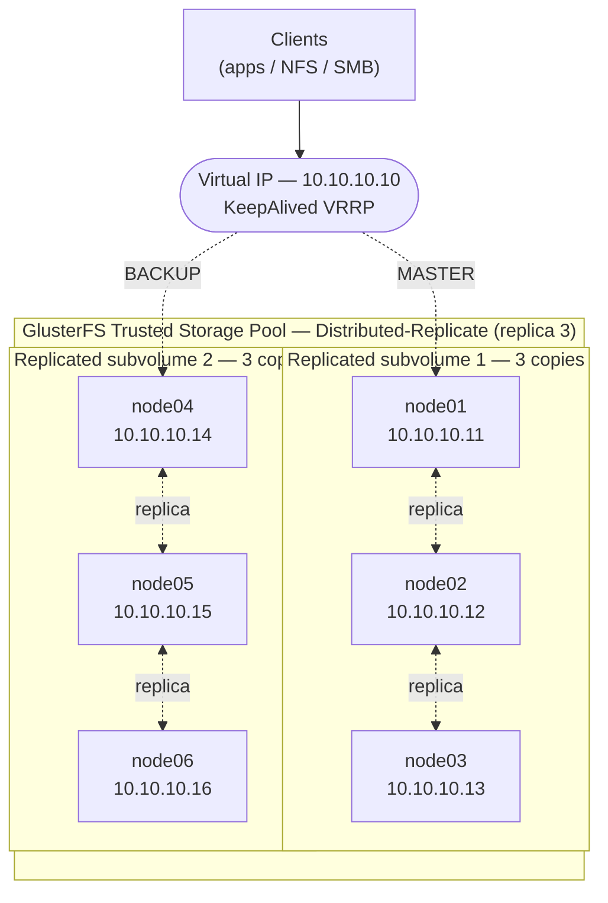

# glusterfs-ha-lab

A reproducible lab that builds a **highly available, distributed-replicated storage cluster** with [GlusterFS](https://www.gluster.org/) and a floating Virtual IP managed by [KeepAlived](https://www.keepalived.org/) (VRRP). Six storage nodes keep **three copies of every file** (`replica 3`) and keep serving through node failures — with no split-brain risk and no client-visible downtime.

> This is a **lab reconstruction** for learning and demonstration. All addresses, hostnames and domains are examples. Nothing here is tied to any production environment.

---

## Problem

A service needs shared storage that stays available when servers fail. A plain NFS export is a single point of failure: if the box serving it goes down, every client stalls. The goal of this lab is a storage backend that:

- keeps redundant copies of data across independent nodes,
- keeps serving reads and writes when nodes are lost, **without ever producing conflicting copies (split-brain)**, and
- exposes a **single, stable endpoint** to clients so failover is transparent.

## Solution

- **GlusterFS** in a `Distributed-Replicate` layout (`replica 3`) across **6 nodes, 1 brick each**. Files are hashed across two replicated subvolumes, and each file is written to **three different nodes**. Distribution gives horizontal scale; replica 3 gives the redundancy.
- **Server-side quorum** (`cluster.quorum-type: auto`) keeps writes safe during partitions: a subvolume that loses its majority goes read-only instead of accepting conflicting writes, so **split-brain cannot occur**.
- **KeepAlived (VRRP)** runs on a MASTER/BACKUP pair and owns a **Virtual IP (VIP)**. Clients that reach storage through an NFS/SMB gateway talk to the VIP, so if the node holding it dies, the VIP moves and the mount point stays the same.
- Everything is provisioned with **Ansible**, so the whole cluster is rebuildable from scratch with one playbook run.

## Result

- **Three copies of every file**, each on a different node — tolerates node loss with no data loss and **no split-brain**.
- **Transparent failover** of the access endpoint via the floating VIP.
- **Repeatable builds**: the cluster is described as code, not as a sequence of manual steps.

---

## Architecture



**Volume `vol0`** — `Distributed-Replicate`, `replica 3`, 6 bricks (brick path `/data/glusterfs/vol0/brick1` on every node):

| Subvolume | Brick A | Brick B | Brick C |
|-----------|---------|---------|---------|
| 1 | `node01` | `node02` | `node03` |
| 2 | `node04` | `node05` | `node06` |

A file is hashed to one subvolume, then written to all three of its bricks. Usable capacity is ~33% of raw (three copies of each file). See [`docs/architecture.md`](docs/architecture.md) for the full reasoning — fault tolerance, quorum, split-brain, and why the VIP matters for gateway clients but not for native FUSE clients.

---

## Prerequisites

- 6 Linux VMs/hosts (e.g. Debian 12 or Rocky 9), each with a dedicated data disk/partition for its brick.
- A control host with **Ansible 2.14+** and SSH access to all six nodes.
- One free IP on the storage subnet for the **VIP**.
- Nodes able to reach each other on the GlusterFS ports (24007/24008 + one port per brick from 49152) and VRRP (protocol 112).

## How to run

```bash
# 1. Copy and edit the inventory with your six hosts and the VIP
cp ansible/inventory.ini.example ansible/inventory.ini
$EDITOR ansible/inventory.ini

# 2. Build the whole cluster (peers, bricks, volume, quorum, KeepAlived)
ansible-playbook -i ansible/inventory.ini ansible/site.yml

# 3. Mount from a client (native FUSE, with failover bootstrap servers)
mount -t glusterfs \
  -o backup-volfile-servers=node02:node03 \
  node01:/vol0 /mnt/vol0
```

## Verify & test failover

```bash
# Cluster health
gluster peer status
gluster volume info vol0
gluster volume status vol0

# Confirm 3 copies / quorum settings are in effect
gluster volume get vol0 cluster.quorum-type

# Who holds the VIP right now?
ip -br addr show | grep 10.10.10.10

# Failover test: stop one node in a subvolume and confirm the volume
# keeps full read/write; stop the VIP's MASTER and confirm the VIP moves.

# After a node recovers, watch the self-heal drain to zero:
gluster volume heal vol0 info
```

---

## Repository layout

```
glusterfs-ha-lab/
├─ README.md
├─ LICENSE
├─ docs/
│  └─ architecture.md          # design decisions, failure analysis, diagram
├─ ansible/
│  ├─ inventory.ini.example
│  ├─ site.yml
│  └─ roles/
│     ├─ common/               # packages, firewall, disk prep
│     ├─ glusterfs/            # peer probe, brick dirs, volume create + quorum
│     └─ keepalived/           # VRRP master/backup + health check
└─ configs/
   ├─ keepalived/
   │  ├─ keepalived.master.conf.example
   │  └─ keepalived.backup.conf.example
   └─ gluster/
      └─ volume-setup.sh.example
```

## License

MIT — see [`LICENSE`](LICENSE).
